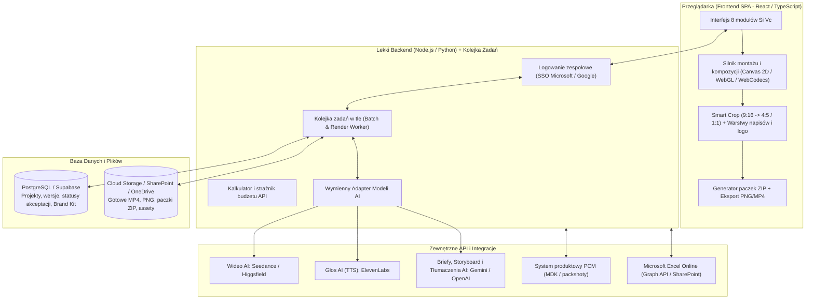

# 01. Architektura i Wizja Systemu — Si Vc (Video Creative)

## 1. Założenie nadrzędne: Autonomiczna aplikacja webowa (Bez ComfyUI)

Koncepcja **Si Vc** wywodzi się z procesów wypracowanych w ComfyUI, jednak docelowy produkt jest **w pełni autonomiczną aplikacją webową** i **nie uruchamia ComfyUI w tle**. Wszystkie procesy generowania, montażu, lokalizacji oraz eksportu realizowane są bezpośrednio przez dedykowane adaptery API oraz silnik kompozycji w przeglądarce i lekkim backendzie.

---

## 2. Architektura Hybrydowa (Client + Lightweight Backend)

---

## 3. Kluczowe Decyzje Architektoniczne

### 3.1. Warstwa generowania AI (Wymienny Adapter)
Zamiast sztywnego przywiązania do jednego narzędzia, backend udostępnia ujednolicony interfejs (`VideoGenerationProvider`, `VoiceProvider`, `LLMProvider`), pozwalający wybrać model w interfejsie użytkownika:
- **Wideo AI:** **Seedance** oraz **Higgsfield** (wybór modelu per kreacja lub zadanie batchowe).
- **Głos i Dubbing (TTS):** **ElevenLabs** (generowanie głosu lektora ze skryptu wraz z precyzyjnymi znacznikami czasu słów `word-level timestamps` pod dynamiczne napisy TikTok/CapCut).
- **Tekst, Briefy i Szkice Tłumaczeń (LLM):** **Gemini / OpenAI** (rozpisywanie promptu na 6-scenowy storyboard oraz generowanie wstępnych tłumaczeń do arkusza Excel Online).

### 3.2. Jedna kreacja, trzy kadry (9:16, 4:5, 1:1)
- **Zasada domyślna:** Wideo AI jest generowane **jeden raz** w formacie bazowym (np. `9:16`), co redukuje koszty API o ~66% i gwarantuje identyczną grę aktorską/ruch produktu.
- **Inteligentne kadrowanie (Smart Crop):** W przeglądarce użytkownik widzi jednocześnie 3 podglądy (`9:16`, `4:5`, `1:1`), może przesunąć punkt fokusu (offset pionowy/poziomy) dla kadrów `4:5` i `1:1`, a warstwa napisów, logo i nakładek dopasowuje się niezależnie do bezpiecznych stref (*safe areas*) każdego formatu.
- **Wyjątek (Osobny render):** Jeśli dla konkretnej sceny lub formatu kadrowanie ucina istotny detal, użytkownik może zaznaczyć opcję wymuszenia oddzielnej generacji AI dla tego formatu.

### 3.3. Tryb Szybki vs Wieloscenowy (Storyboard)
W module **Studio TikTok** użytkownik ma do wyboru dwa tryby pracy:
1. **Tryb szybki (Single Clip):** Jeden prompt generuje pojedynczy klip (np. 5–10 s).
2. **Tryb wieloscenowy (Modularny Storyboard):** Film składa się z 6 scen (np. `Hook`, `Produkt`, `Detal`, `Ruch`, `Hero shot`, `CTA`). Każda scena ma własny prompt, przypisane zdjęcie wejściowe z PCM i generuje osobny krótki klip w Seedance/Higgsfield. Użytkownik może przelosować pojedynczą nieudaną scenę bez ponownego generowania pozostałych pięciu.

### 3.4. Montaż w przeglądarce + Kolejka Batchowa w tle
- **Praca kreatywna i postprodukcja (`#single`, `#post`, `#static`):** Podgląd na żywo i składanie warstw (dynamiczne napisy słowo po słowie, belki tekstowe, animacje logo, nakładki z Brand Kitu, podkład muzyczny BGM) odbywa się natychmiastowo w przeglądarce (HTML5 Canvas / WebCodecs).
- **Produkcja masowa (`#batch`):** Przy dziesiątkach lub setkach kodów `MDK` zadania wykonują się asynchronicznie na backendzie, dzięki czemu użytkownik może zamknąć kartę przeglądarki i wrócić do gotowych materiałów.

### 3.5. Dostęp, Zespół i Kontrola Kosztów
- **Logowanie:** Lekki system kont oparty o **SSO (Microsoft / Google)**.
- **Uprawnienia i akceptacja:** Wszyscy członkowie zespołu mają dostęp do wspólnej przestrzeni projektowej i biblioteki Brand Kit; każde zatwierdzenie rynku w zakładce **Lokalizacja** zapisuje w historii kto i kiedy zmienił status (`Roboczy` → `Do akceptacji` → `Zaakceptowany`).
- **Kontrola budżetu:** Przed uruchomieniem generacji w **Studio TikTok** lub **Produkcji batchowej** interfejs wyświetla estymowany koszt wywołań API (na podstawie wybranego silnika Seedance/Higgsfield, liczby scen, długości wideo i liczby wersji głosowych ElevenLabs).
