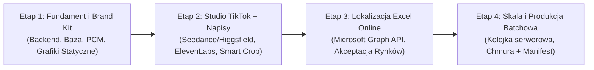

# 04. Roadmapa Wdrożenia i Kontrola Kosztów (Etapy Budowy)

## 1. Podział na Etapy (Od PoC do Pełnej Produkcji)

### Etap 1: Fundament, Połączenie z PCM, Brand Kit i Grafiki Statyczne
- Uruchomienie lekkiego backendu (Node.js/TypeScript lub Python FastAPI) + baza danych (PostgreSQL/Supabase) i logowanie SSO (Microsoft).
- Integracja z **API PCM** (pobieranie zdjęć po `MDK` + ręczny fallback upload).
- Współdzielona biblioteka **Materiały / Brand Kit (`#assets`)** (nakładki, logo/outro, muzyka BGM, fonty marki).
- Moduł **Grafiki statyczne (`#static`)** z szablonami, pozycjonowaniem elementów i masowym eksportem wszystkich rynków i formatów (`1:1`, `4:5`, `9:16`) do ZIP.

### Etap 2: Studio TikTok (`#single`) + Silnik Montażu (`#post`)
- Implementacja wymiennego adaptera wideo AI dla **Seedance** oraz **Higgsfield** (tryb szybki 1 klip + tryb wieloscenowy ze storyboardu z przelosowywaniem pojedynczych scen).
- Generowanie briefu i 6-scenowego storyboardu przez LLM (**Gemini / OpenAI**).
- Integracja z **ElevenLabs** (generowanie głosu lektora + `word-level timestamps`).
- Silnik kompozycji w przeglądarce (Canvas / WebCodecs):
  - **Smart Crop** z jednej generacji bazowej `9:16` na `4:5` oraz `1:1` z regulacją punktu fokusu,
  - **Dynamiczne napisy słowo po słowie** (styl TikTok/CapCut) oraz **belki sceniczne**,
  - Animacje logo, plansza końcowa (outro) i miksowanie podkładu muzycznego BGM.

### Etap 3: Lokalizacja z Microsoft Excel Online (`#local`) i Akceptacja
- Dwukierunkowa integracja z **Microsoft Excel Online (SharePoint / OneDrive)** przez Microsoft Graph API:
  - Wypychanie nowych kluczy kreacji i automatycznych szkiców tłumaczeń AI,
  - Pobieranie codziennych aktualizacji od tłumaczy jednym kliknięciem (plus awaryjny import `.xlsx`/`.csv`).
- Automatyczna kontrola długości tekstów i bezpiecznych stref (*safe areas*).
- Workflow akceptacji rynków (`Roboczy` → `Do akceptacji` → `Zaakceptowany`) z logowaniem historii zatwierdzeń.

### Etap 4: Produkcja Batchowa (`#batch`) i Eksport Chmurowy (`#export`)
- Asynchroniczna kolejka zadań na backendzie dla dziesiątków/setek kodów `MDK` (praca w tle przy zamkniętej karcie przeglądarki).
- Automatyczne rozdzielanie wyjść na **Kartę produktu** (czyste wideo) oraz **Social media** (wideo z szablonem napisów i logo).
- Automatyczny zapis wyeksportowanych plików MP4/PNG i paczek ZIP na **SharePoint / OneDrive / Cloud Storage** wraz z linkami `cloud_url` w `manifest.csv`.

---

## 2. Kalkulator i Kontrola Kosztów API

Przed każdym uruchomieniem generacji w **Studio TikTok** oraz **Produkcji batchowej**, aplikacja wylicza i prezentuje użytkownikowi przewidywany koszt zadania:

| Składnik kosztu | Sposób naliczania | Optymalizacja w architekturze Si Vc |
|---|---|---|
| **Generacja Wideo AI (`Seedance` / `Higgsfield`)** | Koszt za wygenerowaną sekundę / klip bazowy | **Smart Crop (1 generacja → 3 formaty)** obniża koszt wideo o 66%. W trybie storyboardu przelosowujemy tylko pojedynczą scenę zamiast całego filmu. |
| **Dubbing AI (`ElevenLabs`)** | Koszt za liczbę znaków skryptu na wybrany język | Ścieżka głosowa generowana jest raz dla danego języka i współdzielona pomiędzy formatami `9:16`, `4:5` i `1:1`. |
| **Brief, Storyboard i Szkice Tłumaczeń (`Gemini / OpenAI`)** | Koszt tokenów tekstowych (marginalny) | Cache'owanie wygenerowanego briefu oraz synchronizacja z arkuszem Excel Online. |
| **Montaż napisów, logo i kadrowanie (`WebCodecs / Canvas`)** | **0,00 USD** (wykonywane po stronie przeglądarki) | Zmiana tekstu napisu, korekta tłumaczenia z Excela czy podmiana nakładki **nie zużywa kredytów wideo AI**. |
